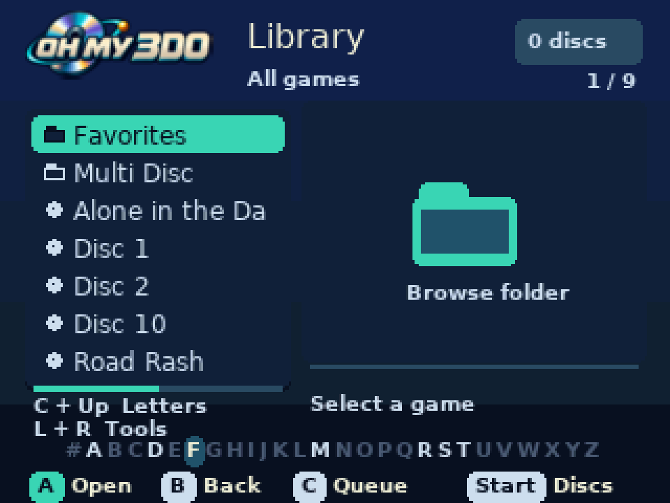
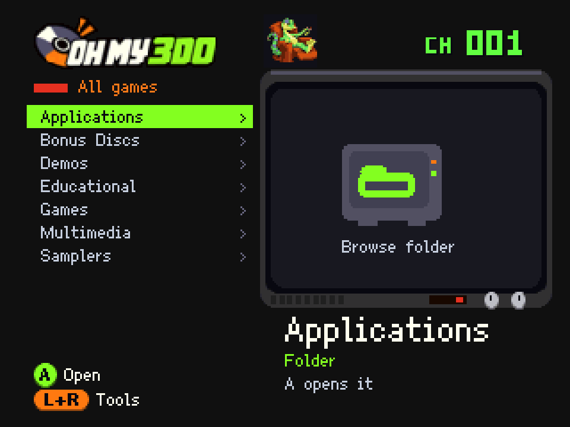

# Oh My 3DO


Oh My 3DO is a replacement `boot.iso` menu for the open-source [FCare/SataTo3DO
ODE](https://github.com/FCare/SataTo3DO). It sorts folders and games by name
instead of FAT insertion order, with folders first and case-insensitive natural
sorting: `Disc 2` comes before `Disc 10`. No firmware update is required.

Features include disc queues, automatic multi-disc grouping, favorites, letter
navigation, saved settings, PNG covers, video previews, and NVRAM backup and
restore. Previews can include game audio. PC tools can identify and organize a USB
library, download covers, and build a game information database. The current
menu version is **0.16.0-rc7**; media tools are **0.16.0-rc6**.



Layout preview rendered from the menu drawing code.

## Install

Download `boot.iso` from the [latest
release](https://github.com/Scyllinice/oh-my-3do/releases/latest). Back up the
existing `boot.iso` on the USB drive, replace it with the download, and cold
boot the console. Keep games in their existing folders.

For the current preview-audio menu, game information panel, and maintenance tools, use the
[v0.16.0-rc7 prerelease](https://github.com/Scyllinice/oh-my-3do/releases/tag/v0.16.0-rc7).

Keep existing settings when upgrading. Version 0.15.0 supports both the legacy
root layout and the consolidated `.ohmy3do/` layout described below. Favorites,
covers, previews, and save backups are optional.

The release also includes `menu-demo.iso`, an offline interface demo. Copy it to
the USB drive as `boot.iso` to preview the layout without sending ODE commands.
It does not launch games. Stock emulators may run the demo but lack the vendor
commands needed by the normal browser.

## Support files and migration

Keep `boot.iso` at the USB root. The consolidated layout stores menu-owned files
under `.ohmy3do/`: `ohmy3do.ini`, favorites, recent history, saved position,
diagnostics, search index, covers, previews, and NVRAM backups. Databases,
transaction journals, and ignored CUE files also live there. Game paths stay
relative to the USB volume and are unchanged by support migration.

**Install the v0.15.0 or newer boot.iso before migrating.** Extract the matching
media-tools ZIP on the PC, then preview and apply:

```powershell
py organize-library.py migrate-support M:/
py organize-library.py migrate-support M:/ --apply
```

The command preserves existing settings, refuses conflicting files, creates the
support subfolders, and prints an undo journal. It also initializes the layout
on a fresh USB drive. Old INI bytes are retained in `.ohmy3do/migration-input/`.
Undo uses the normal organizer `undo` command. Undo the migration before undoing
an earlier organization transaction. Migration does not change game paths or
convert media, and it does not rebuild the ISO.

A nonempty `.ohmy3do/ohmy3do.ini` selects the consolidated layout for the menu
and PC tools. Existing root layouts still work. Empty files created by firmware
probes do not shadow the legacy INI. Menu file reads and writes use the selected
layout consistently. Paths below are relative to this support location unless
shown as full USB paths; generated legacy build exports can be copied into it.
The startup INI selects the menu's layout for the session; use the same layout
on each attached USB volume.


## Build

Docker must be running. The first build downloads the SDK and tools. The default
SDK revision is pinned to `4e370299bd273bb13089d41fa33c5e863dc6d405`.

```sh
./tools/dev-container build
./tools/dev-container test
./tools/dev-container run make test-sdk test-covers
./tools/dev-container menu
./tools/dev-container demo
```

Outputs in `iso/`:

| Output | Purpose |
| --- | --- |
| `boot.iso` | Browser and launcher |
| `menu-demo.iso` | Offline UI demo; does not launch games |
| `*.iso.sha256` | Image checksums |
| `ohmy3do.ini` | Editable startup configuration |
| `favorites.txt` | Editable favorites template |
| `covers/` | Raw PNGs or converted thumbnails and checked index |
| `previews/` | Optional converted video/audio clips and checked index |
| `saves/` | Copy this folder to USB for save backups |
| `library.3di` | Search index generated on the PC by `index-media.py` |
| `metadata.3di` | Genre, publisher, and release date exported from the library database |

Builds preserve existing `iso/ohmy3do.ini` and `iso/favorites.txt`. Source
examples are `ohmy3do.ini` and `favorites.example.txt`. Build audits and signed
LaunchMe executables are retained in `build/console-menu/` and
`build/console-demo/`. The ISO includes the complete pinned SDK bootstrap
runtime and its startup scripts. Each build checks every template file before
adding the menu and artwork, and records component hashes in
`build/console-menu/runtime-audit.json`.

The container targets `linux/amd64` because the legacy compilers are x86
binaries. It includes Norcroft, Python, Wine, ImageMagick and `3it`, and mounts
the workspace with your host UID/GID. Docker's socket and physical devices are
not mounted.

## Controls

| Control | Browser |
| --- | --- |
| Up / Down | Move selection; hold to repeat |
| Left / Right or L / R | Page through the list |
| A | Open a folder or launch a game; offer a matching disc set for Disc 1 |
| B | Parent folder |
| C | Add selected image to the queue when released |
| Hold C + Up | Focus the alphabet strip from anywhere in the list |
| Hold C + Left / Right | Jump to the previous/next initial letter without adding a disc |
| Start | Review the disc queue |
| X | Clear an active find filter; otherwise refresh / retry connection |
| L + R together | Tools: saves, backups, favorites, recent games, find, configuration, help, diagnostics |
| Hold X at startup | Skip USB configuration, artwork, favorites and settings writes |

The browser uses a proportional, mixed-case font, a dedicated artwork panel,
rounded selection cards and controller button badges. The Tools screen has two
columns of four cards; the arrows move between them. Cover images and video
previews share the larger artwork panel.

Game lists hide `.iso` and `.cue` extensions from titles and show an ISO or CUE
label beside each entry. Both formats remain selectable, including when they
share a title. For BIN/CUE games, select the CUE; it describes the tracks and
references the companion data files. BIN files are hidden throughout the browser.
Full filenames and original TOC IDs are retained. Long selected names scroll after a pause;
folder changes reset the animation. Parent navigation restores selection. The
previous listing remains visible while a folder loads. A read failure hides the
listing and prevents selection until the connection recovers. The whole
directory is sorted before paging. Normal text shows seven rows; large filenames
show six.

At a USB root, support entries are hidden: `boot.iso`, `menu-demo.iso`, their
`.sha256` files, `ohmy3do.ini`, `favorites.txt`, `last-position.txt`,
`recent.txt`, `diagnostics.txt`, `.ohmy3do`, and legacy media/support folders.
Identically named entries inside game folders remain visible. Volume selectors
are never hidden. The compatibility workaround retains access to hidden entries
when needed.

## Disc queue and automatic grouping

The queue is intended for discs from **the same multi-disc game**, added in
their required order. Changing the mounted image leaves the first game's program
running; it is not a reliable way to start an unrelated game. Advance when the
game requests the next disc. The menu stops running after launching a game, so
it cannot show a live mounted-disc overlay or detect a game's swap prompt.

Press C on images to add up to 16 discs, then Start to review them:

| Control | Queue review |
| --- | --- |
| A / Start | Apply the displayed order and launch |
| X | Remove the selected disc |
| C | Toggle move mode; Up/Down moves that disc, C or B finishes |
| Hold C, press X | Clear the complete queue |
| B | Return to browsing |

Queue edits happen in menu memory. Before launch, the menu validates every path,
clears the firmware queue, and re-adds discs in the displayed order. It resolves
fresh directory IDs and restores/verifies the browser folder between visits.
Same-folder queues use one fresh directory listing and add every disc in place,
avoiding repeated walks through the folder tree.
This supports discs in different folders and volumes. A missing path prevents
launch; an uncertain append/clear blocks further launch until a confirmed clear.
An XBUS timeout or failed directory restoration requires a console restart. The
queue is not saved across power cycles.

Selecting a recognized Disc 1 with an empty queue offers a matching set before
launch. It recognizes explicit `Disc`, `Disk` and `CD` markers with numbers,
including names such as `D (Disc 1).iso` and `Game CD1.cue`. All entries must be
in the **same folder**, have matching surrounding names, contain unique disc
numbers, and run continuously from 1 through N. Region/revision differences,
duplicate disc numbers, gaps, ambiguous markers and oversized sets suppress the
offer. Files in separate Disc 1/Disc 2 subfolders must be queued manually.

On the proposed-set screen: **A** accepts into queue review, **X** launches only
the originally selected image, and **B** cancels. Acceptance does not launch the
game automatically. The menu cannot establish that matching filenames contain
compatible game data; review the suggestion.

## Favorites and letter navigation

Put `favorites.txt` in `.ohmy3do/`, with one path relative to that USB volume
per line. Use forward slashes and include the actual extension. For example:

```text
# Favorites
Games/Road Rash.iso
Games/D/D (Disc 1).iso
```

Open Tools → Favorites. **A** opens the containing folder and selects the image;
press A again to launch or review a detected disc set. **C** adds the game
currently selected in the browser; **X** removes the highlighted favorite. Both
edits save and verify `favorites.txt` immediately, creating it if missing.
**Start** reloads the list. Select a game before opening Tools to add it.

**R** enters move mode. Up/Down moves the highlighted favorite; **A or R** saves
the new order and verifies it. **B** cancels without writing. Before saving, the
menu re-reads the USB list and checks that it still matches the list opened for
editing. If another edit is detected, cancel and reload instead of overwriting
it.

Missing paths leave the original folder intact when restoration succeeds. A
transport/restoration failure disables browsing until restart. Files are read on
demand, not automatically at startup. Each USB volume can have its own
favorites. Do not include virtual USB device labels in favorites paths.

The list supports up to 64 entries in fewer than 8,192 bytes, with each path
under 1,024 bytes. Blank lines, `#`/`;` comment lines, CRLF/LF and a UTF-8 BOM
are accepted. Traversal components, absolute paths, backslashes, embedded
controls, duplicate paths ignoring ASCII case, and oversized lists are rejected
as a whole. Edits re-read the file first, reject invalid/unreadable lists and
case-insensitive duplicates, and write a canonical path list, replacing
comments/formatting. A NUL terminator hides old file tails because firmware
cannot truncate files. No favorites are saved without pressing an edit button.
The firmware may create an empty missing text file even for a read request.

The alphabet strip below the browser lists **# and A–Z**. Focus it with **C +
Up**, Up from the first entry, or Down from the last entry. Left/Right chooses a
letter, A jumps to its first matching visible name, and B cancels. Down returns
to the first list entry. Letters without matches are dimmed; confirming one
leaves the strip open. `#` covers numeric and other initials. The strip follows
the current name filter and never launches or queues a game.

Hold C and use Left/Right for quick jumps between available initials. A plain C
tap adds a disc only on release, so either alphabet shortcut avoids queueing.

## Remembered position, recent games and finding names

The menu records the last folder and selected entry in `last-position.txt` on
each USB volume. After two seconds without a selection change, the menu saves a
changed position and verifies it. It also saves before launch. On startup it
resolves the folder by name using fresh directory IDs and selects the saved
entry. A missing or renamed folder leaves the startup listing available. A
malformed position file disables automatic position writes for the session;
delete that file on a PC to start fresh. A failed write also stops automatic
position saves for the session. Position data supports the browser's depth and
path limits. The loading artwork stays visible until startup settings and the
saved location are ready, so the browser first appears at its saved size.

Tools → Recent games lists up to ten recent launch selections, newest first.
**A** opens the containing folder and selects the image; **Start** reloads the
list. Paths are recorded in `recent.txt` just before handing control to a game,
so a failed mount can still appear in the list. Repeating a selection moves it
to the top without duplicates. Reads and verified writes share one trip to the
USB root, and repeating the newest cached selection skips the history write.
Long paths may reduce the number of entries;
paths of 1,024 bytes or more are not recorded. Missing paths do not launch a
game, and malformed lists are not overwritten automatically.

Tools → Find a game opens a controller keyboard. Use the arrows to choose a
character, **A** to enter it, **X** to erase, **C** to clear, and **Start** to
search. `SP` enters a space. Search matches game-image names across folders on the
selected USB drive, ignoring ASCII case. An empty query lists all games.

Run the updated `index-media.py` on the PC before using Find:

```powershell
py index-media.py M:/
```

The same command creates cover/preview associations and `.ohmy3do/library.3di`, even when there is no artwork. Find loads this checked file once and
keeps it in RAM. It does not recursively scan folders on the console. Matching
runs once per submitted query; drawing and navigating results use a stored match
list. The initial index read still requires a USB-root round trip.

Results show the selected game's folder to distinguish duplicate names.
**A** opens that folder and selects the game; it does not launch automatically.
**Start** or **B** returns to the keyboard, **X** reloads the index, and Left/Right
or L/R pages through results. Regenerate the index after adding or moving games.
Search covers the selected USB volume; enter a volume before searching from a
multi-device root. The index supports 2,048 games and 128 KiB of cached paths.
Support folders and the menu ISOs are excluded. A missing or invalid index shows
setup instructions instead of starting a slow directory scan.

Both position recording and recent-game recording can be disabled in Settings. Existing INIs use enabled defaults for these new options. Holding X
at startup skips these USB extras. Each USB volume has its own files; startup
restoration uses the boot volume's position file. Recent paths retain volume
labels where needed. A regular history-file failure does not prevent launch,
while an uncertain transport or failed folder restoration blocks it.

## Display preferences and configuration

Tools → Settings exposes every INI setting: additional screen
margins (0–12 pixels), larger game/queue titles, teal/high-contrast/amber/Gecko TV
themes, the folder compatibility workaround, USB covers, video previews,
remembered position, recent games, and preview sound. Left/Right or A changes the selected
value. Preview sound and display changes take effect immediately. Save the remaining
options and cold boot to apply them. The settings list spans two pages; keep
pressing Down to reach the remaining actions, or press C to save from either page.

**Gecko TV** is a Gex-inspired theme with purple TV casing, lime selection
highlights, orange accents, a gecko cursor and original lizard artwork. The
graphical Oh My 3DO logo sits inside the matching TV frame. Select
it under **Tools → Settings → Theme**, then press **C** to save. It can also be
enabled with `theme=3` in `.ohmy3do/ohmy3do.ini`. Existing themes retain their
numbers and the default remains teal. Use desktop v0.1.2 or newer when preparing
a USB copy with Gecko TV settings.



Layout preview rendered from the menu drawing code.

**C** or **Save changes to USB** writes all nine settings, closes/reopens the
file and verifies every byte. B returns without writing; unsaved display
previews remain active for this boot, and edited values remain on the settings
screen. Only a successful save persists after reboot. The unsaved marker
identifies changes that have not been saved. **X** or **Discard unsaved
changes** restores the last successfully saved values, including the display
preview.

The margin moves the menu into an inset area while keeping text at native pixel
size. Antialiased text uses brighter colors and larger glyphs for TV readability.
Game titles use a 12-pixel font, or 14 pixels and six list rows with large titles
enabled. Controls and system tools use a bold 10-pixel font.
Restore display defaults resets only the display settings.

The save writes a canonical INI containing all nine settings and replaces
comments/formatting. It requires a successfully
loaded config. Startup bypass, an invalid config, unsupported identity or a
failed transport prevents saving. The firmware cannot truncate files, so the
menu writes a fixed 512-byte plain-text file with Windows line endings, an
explicit `; End of Oh My 3DO settings.` comment, and space padding. It contains
no NUL bytes. Edit the values above the end comment; text below it is ignored.
Existing NUL-padded INIs still load and become readable text on the next save.
Older menu versions need the trailing space padding removed on a PC before
loading this new format. Do not interpret a failed save as persistent.

You can also edit `ohmy3do.ini` on a PC:

```ini
[compatibility]
folder_workaround=1

[artwork]
usb_covers=1
video_previews=0

[display]
screen_margin=0
large_titles=0
theme=0

[library]
remember_position=1
recent_games=1

[audio]
preview_sound=1
```

`folder_workaround=0` is normal navigation; `1` enables the workaround for
FCare's directory-local ID collision bug. Keep the existing value if folder
navigation already works. `Compat on` appears at the bottom of the browser when
the workaround is enabled. `usb_covers` and `video_previews` are 0/1; previews
default off. Margin is 0–12; large titles is 0/1; theme is 0 teal, 1 high
contrast, 2 amber, or 3 Gecko TV. The two library settings are 0/1. Old configs containing only
the earlier keys remain valid and use display defaults. Unknown/duplicate
settings or invalid values reject the config. PC text must stay below 512 bytes unless it retains all nine settings and the
end comment within the first 512 bytes;
CRLF, LF, UTF-8 BOM and `#`/`;` comments are accepted.

The workaround first selects a safe existing file with the directory command to
change the remembered ID without mounting it or changing the playlist. It can
instead use a safe sibling detour. Intermediate folders are not displayed. With
no safe alternative it reports an error; the separate firmware patch is the
complete fix. See [firmware/README.md](firmware/README.md).

## Save manager and backup-slot details

Tools → Save manager lists files in the console's `/NVRAM` filesystem, their
sizes, and used/free space. Viewing and X refresh are read-only. **A** prepares
a backup of one save; **C** prepares all files, including system settings.

Choose one of eight USB slots. The menu reads and lists the **existing slot
contents before replacement**. C switches between existing and proposed
contents; A proceeds to a separate confirmation, and B returns. Missing/corrupt
slots are identified as empty or invalid; their contents are not presented as
valid saves. Confirming replaces the chosen slot and verifies the completed
archive by closing/reopening and comparing every byte.

Migration creates `.ohmy3do/saves/`. For manual setup, create it first: the firmware cannot create directories.
Before the first backup or restore in a session, an automatic check writes two
patterns to `saves/usb-test.bin` and verifies both. It does not change NVRAM.
The test file can be deleted on a PC; there is no standalone Tools test option.

Tools → USB backups validates an archive and lists its contents. Select one save
to restore, review its filename/size/type and replacement warning, then confirm.
**Before any NVRAM write**, the menu checks space, captures all current saves,
writes them to `saves/recovery.3ds` and verifies that USB backup. Restoring from
that archive uses `recovery2.3ds` to preserve its source. Both recovery files
are listed alongside `slot01.3ds`–`slot08.3ds`.

Restore allocates space before overwriting, retains the exact length and file
type, reads the file back, and takes a fresh snapshot to check that unrelated
saves are unchanged. It never deletes other saves to make room. The confirmation
warns that the recovery archive is replaced. Keep power on until completion:
replacement is **not atomic**, and interruption can damage the selected save.
Keep a verified USB backup on your PC before restoring saves.

Archives preserve filenames, four-byte types, exact sizes and uncompressed data,
with per-file and whole-payload CRC32 checks. Limits are 128 files and 64 KiB
per archive. They are custom file archives, not raw NVRAM dumps, emulator `.srm`
images, Nintendo 3DS files or game-progress editors. Invalid names, checksums,
duplicates and lengths reject the whole archive. Files are self-delimiting so an
old USB tail does not require unsupported truncate/seek commands.

## Desktop library app (preview)

The [native Rust desktop app](desktop/README.md) can import selected ISOs or
source directories, review uncertain matches, add supplied or matching local
covers/previews, download missing covers, and prepare a USB copy. Disc sources
are preserved. The app runs standalone without Python or Docker.

Portable builds are available in the
[desktop v0.1.3 preview release](https://github.com/Scyllinice/oh-my-3do/releases/tag/desktop-v0.1.3).
Extract the download, launch `OhMy3DOLibrary`, and choose the staging library.
Windows x64 and Linux x64 builds are provided; macOS can be built from source
but has not been packaged here. Preview conversion uses separate native
FFmpeg tools, downloadable inside the Windows app. Existing settings and
media remain compatible. The app prefers hardware graphics and falls back to
software when a graphics device cannot be created. Software rendering can also
be selected under Tools & settings; restart the app after changing it.

The console's selected-game panel shows genre, publisher, and release date from
`.ohmy3do/metadata.3di`. Imports and **Rebuild Find index** export this file from
the library database; the CLI `index-media.py` does the same. USB preparation
includes it automatically. The menu reads the index at the USB root and keeps
it in RAM, so browsing adds no metadata I/O. Missing fields show **Unknown**;
when only a release year is available, the menu shows the year. Dates come
from the game metadata and may not describe every regional pressing.

## Keeping a staging library and USB drive updated

`library-maintenance.py` adds missing media to an organized library without a
new identification scan, and prepares a USB copy containing runtime files.
Run these commands from the extracted `media-tools` folder:

```powershell
py library-maintenance.py update-media D:/3DO --emu-movies D:/EmuMovies
py library-maintenance.py update-media D:/3DO --emu-movies D:/EmuMovies --apply
py library-maintenance.py review D:/3DO --report artwork-review.html
py library-maintenance.py prepare-usb D:/3DO M:/ --report usb-copy-report.json
py library-maintenance.py prepare-usb D:/3DO M:/ --report usb-copy-report.json --apply
```

Replace `M:/` with the USB drive's actual letter. Both operations preview by
default. The HTML media report includes cover thumbnails, title/path search,
and a missing-media filter. Cover imports/thumbnails need Pillow; preview
conversion needs FFmpeg and ffprobe. USB validation and copying need only Python.

Media updates preserve existing artwork, disc identities, registrations and
folder locations. New discs first need to be organized or registered and
indexed. The command uses the current database and never hashes game images.
EmuMovies front covers come from `Box`; videos prefer `Video_MP4_HD`, then
`Video_MP4_HI_QUAL`, then `Video_MP4`, selecting one quality per title. Exact
matches are preferred; ambiguous or incompatible regional matches stay
unselected. `--cover-dir` and `--preview-dir` select other local sources.
Conversions are cached by source content and settings; imports are undoable
with the organizer. New previews use 15 fps, a 15-second cap, and source audio.

USB preparation validates the consolidated `.ohmy3do` layout, the boot volume
header/length, settings, Find, disc/CUE paths and indexed media. It checks PNG
chunks and decodes every compressed preview frame. This does not verify the
boot signature or replace hardware testing. A stale Find index must be rebuilt
with `py index-media.py D:/3DO` before copying.

The copy includes disc files, `boot.iso`, settings, indexes, referenced media,
and available favorites/history/saves. PC databases, reports, caches and
recovery data stay on the PC. Existing destination settings, favorites,
history and saves are preserved. Different existing disc files block copying;
updated runtime files are backed up beside the copy report. Each new copy
passes SHA-256 readback before replacement. Interrupted copies can be rerun,
and destination files are never deleted.

Existing discs with the same size and exact timestamp are skipped quickly.
Reuse the same copy report to retain verified-copy receipts, which also avoid
rehashing unchanged copies when FAT rounds their timestamps. `--verify-discs` instead hashes them all, which can take considerable time.
Other runtime files are compared by content. Keep reports, conversion caches
and copy backups outside both library roots. The full command reference is
included in the media-tools ZIP's `README.txt`.

## USB library organizer

`organize-library.py` runs on a PC with Python 3.9+. It is included in
`media-tools.zip` alongside its `library-catalog.py`, `index-media.py`, and
`resize-covers.py` dependencies. Keep the extracted tools together. Install
Pillow for cover conversion:

```powershell
py -m pip install Pillow
py organize-library.py scan M:/ --quick --plan library-plan.json
```

Run this from the extracted tools folder on the PC. Replace `M:/` with the USB
drive. Scanning leaves USB files unchanged and produces `library-plan.json` and
a searchable `library-plan.html` preview. The preview shows original/proposed
paths, identification confidence, category, genre, publisher, year, and unresolved matches.

The report separates **Matched**, **Needs a choice**, **Unidentified**, and
**File problems**. Filename matches already identify a single release or a
marked game-level entry, but do not verify the disc contents. Check a sample
of their proposed paths and accept them together with `--accept-name-matches`.
Unresolved entries stay in place and do not block that batch.

Choose a release or category from the report's dropdowns, then download the
choices as `overrides.json` or `categories.json`. Place those files beside the
tools and scan again with the corresponding flags. Nothing is selected
automatically, and editing the report does not change the plan or USB drive.
Download choices before closing the page. New release choices may expose
category choices on the next scan. File problems need attention separately.

Rebuild the report from an existing plan without rescanning or reading discs:

```powershell
py organize-library.py report library-plan.json
```

Names such as `(Disc 1 of 2)` and compound region labels such as `(EU-US)`
are supported. Different spellings and alternate titles remain suggestions
unless an exact normalized match exists; fuzzy suggestions are not applied.

The first scan downloads the [full Redump 3DO identification DAT](https://redump.info/datfile/3do/)
and the [LaunchBox metadata archive](https://forums.launchbox-app.com/topic/30123-launchbox-games-db-external-scraper/),
currently about 104 MiB for the latter. Only 3DO records are retained in the
parsed catalog; subsequent scans use a local PC cache. Metadata can be incomplete
or inaccurate, and missing fields remain unknown. It describes games rather
than guaranteeing dates or publishers for each regional pressing. Source URLs and download
checksums accompany the generated database. No account or API key is needed.

The full catalog includes demos, coverdiscs, multimedia, educational software,
applications, and audio bonus discs. An online scan automatically upgrades an
older limited catalog cache while reusing downloaded LaunchBox metadata.
Offline scans can still use the older cache, with a warning about missing releases.
`--dat` accepts XML/Logiqx and clrmamepro DATs, either plain text or ZIP.
CUE records in a DAT are excluded from disc-data comparisons; all BIN tracks,
including audio tracks, remain part of checksum verification.

Open the HTML preview before applying changes. The layout is
`<category>/<region>/<title>/<disc image>`, with discs of the same edition in
one folder. Categories are `Games`, `Demos`, `Samplers`, `Applications`,
`Multimedia`, `Educational`, and `Bonus Discs`. Redump categories take precedence
over title/genre heuristics; explicit category choices take precedence over both.
`Video` maps to Multimedia, `Coverdiscs` to Samplers, and `Add-Ons` to Games.
Unclassified catalog types still need review. Compound regions use their first
listed region for the folder while retaining the full release name. For example:

```text
Games/USA/D (USA)/D (USA) (Disc 1).iso
Games/USA/D (USA)/D (USA) (Disc 2).iso
Samplers/USA/3DO Interactive Sampler CD 2, The (USA)/...
Multimedia/USA/20th Century Video Almanac (USA)/...
Educational/USA/Learning title (USA)/...
Bonus Discs/Japan/Game title (Japan)/...
```

Classification uses catalog title labels, release type, and genre. Explicit demo
labels go to Demos; sampler discs go to Samplers; utilities go to Applications;
multimedia/reference discs such as atlases and almanacs go to Multimedia. Full
game compilations remain Games, and games containing full-motion video are not
classified as multimedia solely because they contain video.
Educational software, including educational games, goes to Educational. Clear
reference titles take precedence over a broad Education genre, and explicit
demo/sampler labels take precedence over the educational theme.

Bonus discs have their own **Bonus Discs** category. Explicit bonus-disc labels
and existing folders named `Bonus Discs` (including numbered names such as
`4 Bonus Discs`) identify extras separately from the base game. A manual
category choice takes precedence. Bonus-disc filenames retain their source
labels, such as `[CD-Audio]`, within the menu's filename limits. This also keeps
their CUE companions separate from the main game's files. An unidentified
extra still needs a release match before it can move; the folder alone does
not identify its contents.

Uncertain classifications are marked **category-review** and stay in place,
even with `--accept-name-matches` or a verified checksum. Examples include mixed
sampler/utility discs, missing genre information, and music or life-simulation
labels that do not establish a category. The HTML preview
shows the evidence for each choice. These are catalog-based classifications;
the script does not inspect the content inside a disc image to determine its type.

Choose categories in a separate PC-side `categories.json` file, using the current
relative disc paths copied from the preview:

```json
{
  "Unsorted/3DO Game Guru.iso": "Applications",
  "Unsorted/Interactive reference disc.iso": "Multimedia",
  "Unsorted/Educational game.iso": "Educational"
}
```

```powershell
py organize-library.py scan M:/ --quick --categories categories.json --plan library-plan.json
```

Category choices are saved in the USB library database during apply and retained
by later scans of the same identified title at its new path. After moving files,
omit `--categories` to reuse those choices, or update the file with current paths
to change them. Identification overrides (`--overrides`) remain separate: a
category choice cannot identify an unmatched disc. Old plans must be regenerated
with this version before apply. Existing cached source downloads are reused
when the parsed catalog is upgraded to include release type.

`--quick` matches filenames without reading entire disc images. These matches
are marked **review**, and moving them requires an explicit option:

```powershell
py organize-library.py apply M:/ --plan library-plan.json --accept-name-matches
```

Without `--quick`, scanning reads each image/data file and compares complete
SHA-1 hashes and sizes against the identification catalog. This can take a long
time on a large USB drive. For whole-sector 2048-byte ISOs with a plausible
catalog track size, the scanner also reconstructs standard Mode 1 headers,
EDC and ECC in memory and compares the resulting 2352-byte-sector checksum.
The source ISO stays unchanged. Both checksums are computed in one read, with
bounded memory and progress messages during long reads.

`checksum` identifies a byte-for-byte catalog dump. `converted-checksum`
identifies the complete single-track catalog image after reconstruction; both
are **ready** without `--accept-name-matches`. `data-track` identifies only the
first track of a multi-track catalog entry and remains **review**: absent audio
or other tracks have not been verified or restored. Accept it explicitly with
`--accept-name-matches` only after reviewing the missing-track warning. Shared
checksums across releases stay ambiguous even when the filename suggests one.
Modified images, nonstandard headers, trimmed sectors, gaps and Mode 2 data
are not repaired or guessed; unsuccessful reconstruction leaves the existing
filename/manual identification workflow available.

A single title with different release labels is reported as `unverified-release`,
with its catalog suggestion, rather than claiming that multiple releases matched.
A familiar name never certifies a modified, trimmed, or uncatalogued build.
Full scans also report matching data-file checksums across separate copies.
CUE layouts are not compared by that duplicate warning; nothing is deleted or
merged automatically, and destination collisions still require a decision.

To check existing guesses, write a separate plan without `--quick` or
`--overrides`. Explicit overrides still take precedence over identification
and are labeled `manual`, even during a full scan:

```powershell
py organize-library.py scan M:/ --plan verified-plan.json
```

The release ZIP includes native accelerators for Windows x64 and Linux x64.
Keep them beside the Python tools; no compiler or extra Python package is
needed on those systems. Other systems use a slower Python fallback. To build
an accelerator from a source checkout, run `python3 tools/build-sector-codec.py`.
From the extracted ZIP, run `python3 build-sector-codec.py --output .` with a C
compiler installed. The Windows cross-build uses Clang and LLD:
`python3 tools/build-sector-codec.py --windows`. These helpers run on the PC
and are never included in `boot.iso`. `--dat` also accepts a local
clrmamepro-format DAT, including one for the ISO format in use.

ZIP files are not scanned or renamed into ISOs; extract them first and preserve
their BIN/CUE or ISO contents. Empty data files and recognized archive headers
disguised as disc images are blocked before identification, even with an
explicit override. Apply repeats these checks before any moves, including for
older saved plans. The standalone indexer omits empty/archive-disguised ISOs
from Find and artwork associations. These checks do not replace checksum
verification or repair damaged images.

Ambiguous versions, fuzzy suggestions, broken/shared CUE sets, and destination
collisions stay in place. No duplicate images are deleted. To resolve a match,
put its relative USB path and exact catalog name in a PC-side overrides file,
then rescan:

```json
{"Unsorted/game.iso": "Doom (USA, Japan)"}
```

```powershell
py organize-library.py scan M:/ --quick --overrides overrides.json --plan library-plan.json
```

Release labels such as `(Alt)`, `(Rev 1)`, and `(Beta)` are retained, including
labels present only in the DAT's track filenames. If distinct dumps still share
a release name, filenames gain a stable eight-character code such as
`Game (USA) [Variant 1A2B3C4D].iso`. The code comes from the catalog's data-file
checksums, not scan order. Identical copies and serial-only catalog duplicates
do not get separate variant codes. Filename-only scans leave unnamed variants
ambiguous unless the filename or an explicit override identifies the code.
Rescan to generate a new plan after updating the organizer.

Disc suffixes such as `- Disc 1`, `Disk 02`, and `CD3` are recognized as well as
`(Disc 1)`. Candidates are restricted to the matching disc number. Disc numbers
and variant codes survive filename shortening. CUE companions receive the same
variant label and updated references. Opaque codes identify individual dumps;
they do not establish which differently coded discs belong to the same edition.
Such discs stay in the common game folder and can be queued manually.
Matched discs with the same category, region and game/edition title are moved
into that common folder even when they started in separate folders. Disc
numbers remain in filenames; unresolved entries and destination conflicts
still need review. Empty source folders can be removed with `clean-empty`.

When the filename has no region, clearly named parent folders such as `US`,
`USA`, `1 US`, or `Japan` narrow filename candidates. A region in the filename
takes precedence. Conflicting folder hints do not choose a region, and a known
catalog serial that conflicts with the inferred region remains ambiguous.
Folder hints still produce unverified filename matches requiring review.

Bracketed product/hub codes are matched against catalog serials within the
same title and disc number. An exact, unique serial match can identify a release
without reading the whole image, but does not verify its contents. If a code is
absent from the DAT, the organizer can make a **game-level** match when title,
region, and shared game metadata agree. It preserves the code in the filename
and marks the exact edition unresolved, without assigning a Redump revision.
For example, `Dragon's Lair [DH 65003].iso` and
`Dragon's Lair [DH 65003-2].iso` under `1 US` remain separate as
`Dragon's Lair (USA) [DH 65003].iso` and
`Dragon's Lair (USA) [DH 65003-2].iso`. Their matching code-specific covers are
preferred. The database records `variant`, `catalog_name`, and
`edition_unresolved`; unresolved game-level entries have no catalog edition name.

To add an uncatalogued or alternate build to Find and the database while keeping
its existing filename and folder, use `register`. It does not download metadata
or assign a catalog release. Preview first, then repeat with `--apply`:

```powershell
py organize-library.py register M:/ "Games/USA/Example/Example.iso" --title "Example" --region USA --category Games
py organize-library.py register M:/ "Games/USA/Example/Example.iso" --title "Example" --region USA --category Games --apply
```

Registration records the disc as `unverified`, hashes every source file, and
updates Find and the database with an undo journal. Disc files remain in place.
Existing covers/previews are preserved. Unchanged registrations survive later
scans; a full scan rechecks SHA-1, while a quick scan checks size and timestamp.
Changed files require fresh identification or explicit registration. ISO
registration checks the 3DO volume header and sector alignment, but does not
certify signatures or hardware bootability. Existing checksum-verified catalog
entries cannot be downgraded through `register`.

Audio-only CUEs stay in place during ordinary organization. They are reported
as audio discs rather than identified as the companion game by title. Use the
[audio-disc converter](#audio-bonus-discs) for WAV sets, then register the
resulting CUE with `--category "Bonus Discs"` to add its title to the database.

CUE sets move together. Companion files receive names derived from the disc
and track number, and their CUE `FILE` references are updated. Comments, track
directives, line endings, and supported source encodings are preserved. Only
sibling-file references are supported; CUE paths into other folders need manual
attention. Case-insensitive file references work on FAT and on a Linux-hosted
test directory. Useful CUEs and their data/audio files remain one move group.
A CUE containing only one MODE1/2048 ISO track at 00:00:00 is redundant. The
organizer uses its ISO and archives the CUE under `.ohmy3do/ignored-cues/` on
apply, with byte-for-byte undo. Existing CUE-based choices, favorites, history,
position, covers, and previews follow the ISO. BIN/CUE, audio, multiple tracks,
gaps, extra indexes, unknown directives, and broken/shared sets are retained.
The standalone indexer also omits verified redundant wrappers. This does not
merge separate ISO copies or resolve their destination collisions.

Apply downloads available [Libretro box scans](https://github.com/libretro-thumbnails/libretro-thumbnails),
prepares 84×105 RGB PNGs, and links them to the correct game paths. Existing
cover and preview associations are preserved. Missing or ambiguous artwork is
reported without blocking other games. `--no-covers` skips cover downloads and
imports. Use
`--offline` on scan/apply to work from existing caches; `scan --refresh-catalog`
refreshes the identification and metadata sources.

Use `--cover-dir` to import local front-box images instead of downloading covers.
Point it at the front-cover folder inside an EmuMovies download, rather than a
parent containing screenshots, logos, and back covers:

```powershell
py organize-library.py apply M:/ --plan library-plan.json --accept-name-matches --cover-dir "D:/EmuMovies/Panasonic_3DO/<front-cover-folder>"
```

Replace `<front-cover-folder>` with the actual folder name. Subfolders are
searched. PNG, JPEG, WebP, BMP, GIF, and TIFF are supported; install Pillow with
`py -m pip install Pillow`. Images are resized to native 84×105 RGB PNGs, indexed
automatically, and included in the undo journal. Originals and existing USB
covers are retained. Local imports work offline and do not fall back to network
downloads. Missing, ambiguous, or unreadable images are reported and skipped.
Matching follows the same exact-name/unique-title rules as preview imports,
including region and disc checks. A generic cover can serve every disc of a
game. The JSON export records the image's relative source filename.

To import downloaded gameplay clips during apply, add
`--preview-dir "C:/EmuMovies/3DO"`; see the EmuMovies workflow below. Existing
previews take precedence. New clips and their index associations are included
in the same undo journal as the disc moves.
`--cover-dir` and `--preview-dir` can be used together on the same apply command.
No ISO update is needed for either import feature.

Favorites, recent games, and the selected saved game are updated to the new
paths. If a saved folder loses its contents, the saved position resets to the
USB root. The search and artwork indices are rebuilt automatically. Original
empty game folders are retained. `boot.iso`, INI settings, save backups, and
music are left in place.

Remove empty folders left after organizing with `clean-empty`. Preview first,
then add `--apply` to remove them:

```powershell
py organize-library.py clean-empty M:/
py organize-library.py clean-empty M:/ --apply
```

This removes empty folders from the bottom up without deleting files. Folders
containing unmatched discs, notes, artwork, or hidden files remain. Support
folders, hidden folders, Windows system folders, symlinks, and junctions are
skipped. No scan plan or downloads are needed. Organizer undo still works and
recreates folders needed to restore the moved discs.

Menu-written text ends at its first NUL terminator; old bytes after that point
are ignored when updating favorites, history, and saved position. An invalid
saved-position file is reset to the USB root with a warning, and undo restores
its original bytes. Text updates are prepared before any disc moves begin.

The USB database lives in `.ohmy3do/library.sqlite`, with a readable
`.ohmy3do/library.json` export. SQLite's `games` table contains paths, titles,
regions, disc numbers, genre, publisher, year, developer, match type, and cover
associations, plus category, classification evidence, and a category-review flag.
The `games` table includes supported disc images from all seven categories.
These information fields are available for PC tools; the current
console menu uses the generated search/artwork indices and does not yet display
genre, publisher, or year.

Apply prints an undo journal path. To restore original file paths and support
files, use that relative path on the same USB root:

```powershell
py organize-library.py undo M:/ .ohmy3do/transactions/<printed-id>.json
```

The journal is written before moves and support-file replacements, including
CUE edits. Apply attempts to undo a failed operation automatically. After an
interruption, keep the journal and run undo before rescanning. Undo checks for
later edits and refuses to replace changed files. Journals remain on USB after
undo. Download caches remain on the PC. On Linux/macOS, replace `py` with
`python3`; `--cache <folder>` before the subcommand selects a different PC cache.

## PNG covers and video previews

Game media belongs in `.ohmy3do/covers` and `.ohmy3do/previews` on USB, outside `boot.iso`. PNG
covers can be copied directly: no image conversion or ISO rebuild is needed. The
menu decodes them into the cover area and preserves their aspect ratio.
Transparency is blended against the artwork background. PNGs can be up to
1024×1024 pixels and 512 KiB. For faster loading, prepare opaque 84×105 RGB
PNGs with the tool below; these match the artwork panel at native size and
avoid resizing and alpha blending on the console. Earlier versions reduced
covers to 64×80 and then stretched them; native PNG covers now retain all 84×105
pixels. Smaller PNGs and legacy 64×80 converted covers use smooth enlargement.
For sharper detail, prepare covers again from the original artwork, since an
already reduced image cannot recover discarded detail.
RGB, RGBA, grayscale, indexed, 1/2/4/8/16-bit and interlaced PNGs
are supported where valid for their color type. JPEGs still need conversion.

The menu keeps six decoded covers in RAM (about 104 KiB of pixel data). Returning
to a cached cover skips USB access, PNG decoding, and the normal selection wait.
Cache entries are separated by USB volume. Press **X** in the browser to refresh
after replacing cover files; reconnecting clears the cache as well. Cache
allocation is optional, so a memory shortage does not prevent a cover loading.
First-time loads still need the firmware's USB file access and a verified return
to the game folder. LOCODE restores check ancestor folder records directly where
safe, retaining full enumeration for compatibility detours and final verification.

To resize or convert artwork, use `resize-covers.py` from the release's
`media-tools.zip`. It needs Python 3.9+ and Pillow. On Windows:

```sh
py -m pip install Pillow
# Check existing artwork without changing it:
py resize-covers.py "E:/.ohmy3do/covers" --check
py resize-covers.py "Downloads/cover.jpg" "E:/.ohmy3do/covers/Road Rash.png"
# Or process a folder, preserving image basenames:
py resize-covers.py "Downloads/artwork" "E:/.ohmy3do/covers"
py index-media.py E:/
```

The tool creates 84×105 RGB PNGs, matching the cover texture used by the menu.
It preserves aspect ratio with dark padding, applies EXIF rotation, and blends
transparency against the artwork background. JPEG, PNG, WebP, BMP, TIFF, and GIF
are supported through Pillow; animated inputs use the first frame. Originals
stay intact. Existing covers require `--overwrite`; `--recursive` includes
subfolders in a flat output folder. Duplicate output names are rejected before
conversion. Keep output outside the input folder and match game basenames.

On Linux/macOS, replace `py` with `python3`. From a source checkout, the tool is
in `tools/`. Docker includes its dependencies after rebuilding the image:

```sh
./tools/dev-container build
./tools/dev-container resize-covers artwork iso/covers
```

Copy the prepared covers to USB and regenerate its media index. Existing valid
PNGs can still be copied directly; resizing is optional. `--check` reports each
image's dimensions, mode, and size, and exits with status 1 if preparation is
recommended. `index-media.py` also warns about PNGs different from 84×105 without
changing the artwork. Prepare replacements in a separate folder, then copy the
prepared PNGs into `covers/` and regenerate the index. Diagnostic exports include
the last cover load's milliseconds, ODE command count, and cache-hit flag.

The filename matches the game's basename, ignoring ASCII case. For example:

```text
USB/
  boot.iso
  Games/
    Road Rash.iso
  .ohmy3do/
    ohmy3do.ini
    favorites.txt
    library.3di
    covers/
      Road Rash.png
      index.3di
    previews/
      Road Rash.3dv
      index.3di
    saves/
```

After copying PNGs, generate the media indices on a PC. Python 3 is enough;
Docker and FFmpeg are not needed for PNG covers. The release includes a portable
`media-tools.zip` with the portable Python tools, a quick-start guide and an original
moving test-pattern clip. Rename that clip to match a game's basename for an
initial preview test without installing FFmpeg. From a source checkout, run:

```sh
python3 tools/index-media.py /path/to/USB
```

On Windows, run `py tools/index-media.py E:/`, substituting the USB drive
letter. With the portable ZIP, run `py index-media.py E:/` from its extracted
folder. The indexer scans game paths and writes small `index.3di` files plus
`library.3di` for Find, leaving the media files unchanged. The firmware does not
list PNGs or preview files in its browser, so these indices are still needed. Existing valid associations are
preserved when their game and media files still exist, including older `.3dc`
covers; a matching PNG basename takes precedence. Games in different folders
with the same basename share the matching artwork. Each index supports up to
2,048 associations / 128 KiB. Media basenames must fit 96 UTF-8 bytes. No
footage is downloaded by these tools. The organizer can download covers and
import clips already saved on the PC.

Video previews are **64×80 RGB555 loops with optional game audio**, fitted
into the artwork area. The PC converts MP4/AVI/MKV/MOV/WebM sources; the console
plays the prepared `.3dv` file from RAM. Install **v0.16.0 or newer** for the new
compressed-video/audio format. Older silent previews remain supported.

New previews are capped at **15 seconds at 15 fps**, including source audio.
Shorter sources stay shorter. Complex footage is shortened further when needed
to fit the **1 MiB combined video/audio payload**; frame rate is never reduced
automatically. `--duration` can request a shorter clip, and older commands asking
for more than 15 seconds are capped automatically. Conversion decodes the source
once and reports the actual duration, frame rate and RAM size.

**15 fps files require v0.16.0-rc2 or newer.** The 15-second policy is a PC-tool
update; RC2 `boot.iso` does not need replacement. Existing previews are unchanged
until reconverted. The player still accepts older longer files within its format
limits. Lower frame rates can be requested explicitly with `--fps`.

Video frames use lossless zlib compression of RGB555 pixels. Audio is signed
8-bit mono PCM at 11,025 Hz, with modest headroom and short endpoint fades.
Playback requires no USB reads. Audio and video restart together each loop;
changing selection stops both. Allocation or audio initialization failures leave
the menu usable; audio failure allows silent video playback.

```sh
./tools/dev-container preview artwork/road-rash.mp4 'iso/previews/Road Rash.3dv'
# Explicit length and starting point:
./tools/dev-container preview artwork/road-rash.mp4 'iso/previews/Road Rash.3dv' --start 10 --duration 10
```

Copy the generated `.3dv` into `.ohmy3do/previews` on USB, then run the indexer
against that drive. With Python 3.9+, FFmpeg and ffprobe installed locally:

```powershell
py prepare-preview.py input.mp4 "M:/.ohmy3do/previews/Road Rash.3dv"
py index-media.py M:/
```

Use `--silent` to omit audio. `--frames 24 --fps 6` explicitly generates the old
four-second silent format for older menu builds. This legacy option cannot be
combined with `--duration`.

Enable **Video previews** in Tools → Settings, save, and cold boot
(or set `video_previews=1` under `[artwork]` in the INI). **Preview sound**
controls audio separately and saves as `preview_sound=0/1` under `[audio]`.
Previews remain disabled by default. Existing `menu_music` INI keys are accepted
for compatibility and ignored; background music and its bundled sample have
been removed. Existing music files are not read or deleted.

### Importing EmuMovies clips

Download the **3DO Video Snaps** to a separate PC folder using
[EmuMovies Sync](https://emumovies.com/faq/4-questions-about-emumovies-sync)
with a supporting membership, or extract a downloaded 3DO video pack there.
Keep that folder limited to 3DO clips and keep the original game-based filenames.
MP4, AVI, MKV, MOV, and WebM files are supported. Subfolders are searched.

Install FFmpeg on the PC and make sure `ffmpeg` and `ffprobe` are available on PATH. Scan the
drive, review the HTML plan, then apply it with the clip folder:

```powershell
py organize-library.py scan M:/ --quick --plan library-plan.json
py organize-library.py apply M:/ --plan library-plan.json --accept-name-matches --preview-dir "C:/EmuMovies/3DO"
```

The organizer prefers exact catalog/source names, then a unique normalized
game-title match. Known region and disc labels must agree. A generic clip
without a disc label can serve all discs of a game; duplicate clips or uncertain
matches are reported and skipped. It does not infer the edition of an ISO from
the clip. Rename or remove duplicate source clips before running a new scan and
apply if a match needs attention.

Imports use up to 15 seconds at 15 fps with source audio, shortening further to fit RAM.
Add `--preview-start 5`, `--preview-duration 10`, or `--preview-silent` as needed.
Clips are converted before USB changes, indexed automatically, and covered by
the organizer's undo journal. Existing previews are retained by default.
To upgrade existing silent clips, add **`--replace-previews`**:

```powershell
py organize-library.py apply M:/ --plan library-plan.json --accept-name-matches --preview-dir "D:/EmuMovies/Panasonic_3DO/Video_MP4" --replace-previews
```

This selects newly converted previews without deleting old media files or PC
originals. Explicit preview associations take precedence over older same-name
files during reindexing. Conversion failures are reported without blocking
other games. The database records each imported clip's filename and relative
source filename. Install the new `boot.iso` once; subsequent preview changes
require no ISO rebuild. Review a fresh plan before applying to reorganize files.

The tool does not log into EmuMovies or store account credentials. Direct API
integration requires separate developer access from
[EmuMovies](https://emumovies.com/forums/topic/58984-new-2023-emumovies-api-available-to-developers/).
Downloaded footage is not included in this repository or its releases.

Covers start loading after 350 ms without a selection change; previews wait 1.2
seconds. A whole clip is checked and loaded into RAM before playback, so looping
needs no USB reads. The new payload cap is 1 MiB, plus a frame buffer and decoder
state. Longer clips may take longer to load and can be cancelled. Pressing a button
cancels an in-progress media load or stops playback. Selecting another game
releases the clip; a stopped clip waits for a new selection before retrying.
Missing, corrupt or cancelled previews leave the static cover available. Actual
USB loading time depends on the firmware and folder navigation. The diagnostics
export includes `preview_result`, `preview_load_ms`, `preview_sound` and
`preview_audio_status` for the last attempt. The
binary layouts are documented in [docs/media-format.md](docs/media-format.md).

For faster cover reads, convert artwork to the compact `.3dc` format:

```sh
./tools/dev-container cover 'Games/Road Rash.iso' artwork/road-rash.jpg
```

That exports a 64×80 RGB555 `.3dc` plus its index into `iso/covers`; see
[assets/covers/README.md](assets/covers/README.md). Copy those files to USB.
`tools/dev-container media-index USBROOT` also runs the indexer for a directory
inside the mounted project. Rebuilding the ISO exports the project's legacy
cover associations into `iso/covers`. Generate raw-media indices against the
actual USB drive after copying the media files.

Media access temporarily visits the selected USB root and restores the original
folder using fresh listings and the compatibility workaround. A failed restore
blocks browsing. Cold boot or refresh at the USB root reloads both indices.
Holding X at startup bypasses USB media access. The project logo/loading screen
and offline demo covers stay embedded in the ISO.

## Audio bonus discs

`prepare-audio-disc.py` combines an audio-only WAV/CUE set into one BIN/CUE
pair, preserving its samples and recorded track gaps. It requires Python 3.9+
and CD-quality PCM WAVs; FFmpeg and an ISO rebuild are unnecessary.

```powershell
py prepare-audio-disc.py "D:/rips/album.cue" "D:/3DO/Bonus Discs/USA/Album (Audio CD)"
py index-media.py D:/3DO
```

Choose a new output folder, then select its CUE in the menu. Original files
remain in place. The converter verifies each output track and writes a local
`audio-disc.json` with source and output hashes. It supports one WAV per track
with INDEX 00/01; unsupported layouts are rejected.

These images need a playback test on the installed ODE firmware. The
[open-source firmware](https://github.com/FCare/SataTo3DO/blob/main/src/interfaces/MSC.c)
has audio-only BIN/CUE support, but unusual first-track pregaps can expose
firmware limitations. Conversion preserves the supplied rip; it does not verify
which catalog release it belongs to.

## Diagnostics and compatibility limits

L+R → Diagnostics has three pages (Left/Right): reported identity/revision and
raw `93` reply; active settings and session results; XBUS replies, command
count, last fault, timeout and navigation state. Viewing diagnostics sends no
commands and remains available after a transport failure. USB write-check
results appear only after the automatic check has run.

**C** exports a verified `.ohmy3do/diagnostics.txt`. The report includes
the raw identity reply, command/reply and retained fault, active settings, queue
state, save results, and position/history results. It snapshots these values
before export I/O changes the bus counters. Export is unavailable after a
transport timeout or failed directory restoration, with startup bypass, or at
the virtual volume selector; viewing the screens still works. Result codes are
`1` for success, `0` for not attempted, and `-1` for failure. Export replaces
the previous report. It is padded to a fixed 4 KiB, so blank lines at the end
are expected.

`LOCODE 1.1.0` matches the reference source but is hard-coded there, along with
boot flags. It does not identify the exact firmware binary, board or flash size.
USB file operations are gated to `LOCODE`; that gate is not proof that every
binary using the name behaves identically. Hold X at boot for recovery without
these optional file operations. No firmware dumping or flashing is performed.

The reference firmware opens files with read/write access and creates missing
files even on reads. Reads can misreport EOF and writes can misreport short
writes. Text buffers are fully cleared before reading; binary inputs are bounded
and checksummed. Verified writes poison every requested readback byte with the
complement of its expected value before comparing actual data. No unsupported
create/seek/truncate/rename commands are used. Read-only USB storage can reject
these operations. All XBUS requests have a three-second timeout; a partial FIFO
exchange requires console restart rather than blind retries.

Other limits: 2,048 entries per directory, 32 navigation levels, ASCII natural
sorting/case folding, and `?` display for unsupported characters. Queue paths
are bounded. No in-game overlay, automatic return-to-menu, NVRAM
formatting, defragmentation, save deletion or Unicode collation is provided.
Image formats visible to the browser depend on the installed firmware.

## Testing and repository setup

Portable host tests (video conversion tests need FFmpeg and ffprobe on PATH):

```sh
make test
```

Optional firmware-function tests and actual-draw layout previews need pinned
reference sources, downloaded separately into ignored `third_party/`:

```sh
./tools/fetch-references
make test-firmware
python3 tools/preview-menu.py
```

The firmware reference test reproduces the original folder-ID bug and checks
navigation against both the original and patched implementations. Host tests
cover sorting, queues, disc grouping, favorites, recent games, settings, media
loading, USB failures, and save backup and restore.

Preview files in `build/menu-preview-*` render the actual draw/input routines
with host graphics stubs and the bundled bitmap font. These are layout previews;
console testing is still needed to check hardware rendering and behavior.

SDK checks verify the formatter ABI and inspect ARM stack allocations against
the 32 KiB task stack. ISO builds preserve the complete bootstrap runtime,
compare packed payloads with their sources, and verify both the ISO and the
retail LaunchMe signature. Build audits record source and tool hashes.

GitHub Actions is disabled. Tests and builds run locally, with no hosted
workflow runners, artifact storage, or scheduled CI jobs. `.gitignore` excludes
generated builds, reference checkouts, personal artwork, game images, saves,
caches, and credentials. `.dockerignore` limits the build context to the
required source, vendored dependencies, tests, configuration, and build tools.

See [CONTRIBUTING.md](CONTRIBUTING.md), [LICENSE](LICENSE),
[THIRD_PARTY.md](THIRD_PARTY.md) and [asset provenance](assets/README.md).
Dependencies retain their own terms. This project is a new menu implementation;
it does not patch the original compiled Fixel menu.
